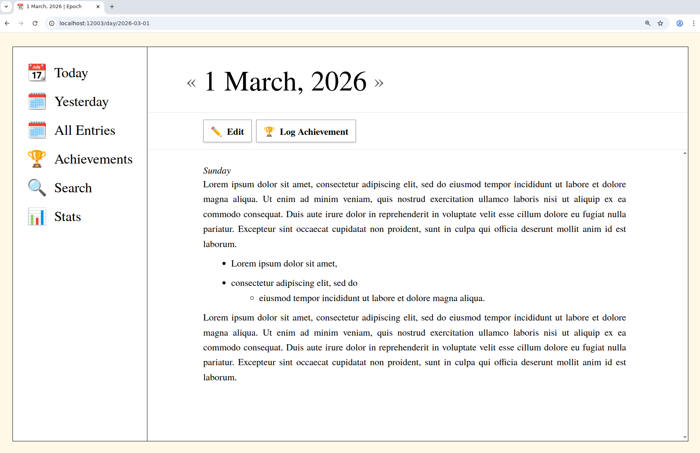

# epoch

A self-hosted journal app.

## Screenshots

## License

© 2026 [Fernando Borretti][fb]. Released under the [MIT][mit] license.

[fb]: https://borretti.me/
[mit]: https://spdx.org/licenses/MIT.html
